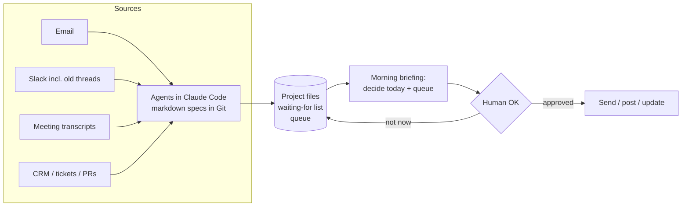

# AI operations system: agents I run every day

I'm Marisa Bechara, a product and customer success leader based in Barcelona. This repo shows the method I use to run my own work with AI agents, as a working example of the kind of systems I design for teams.

Everything here is a generic version of the method: specs, a small tool I wrote, and fictional examples. It contains no client or personal data.

## What the system does

Several workstreams share one method:

- **Morning briefing.** One agent reads email, Slack, meeting notes and project files and produces a single briefing: what needs a decision today, what is overdue, what I'm waiting on from others, and draft replies.
- **Reply watcher.** Every request I send to someone becomes a row in a "waiting for" list. The watcher checks each one in its exact place (thread, email, ticket, PR) and tells me when the answer arrives, with the next step ready.
- **Meeting capture.** After every customer call, an agent reads the full transcript and updates the account file: decisions, commitments with owner and date, risks.
- **Decide today + queue.** Any summary shows at most 3 decisions; everything else goes to a queue and is worked one topic at a time.
- **Human in the loop.** Agents prepare; nothing leaves (email, Slack, LinkedIn, forms) without my explicit OK.

## What's in this repo

| Path | What it is |
|---|---|
| `agents/morning-briefing.md` | Spec of the morning briefing agent |
| `agents/reply-watcher.md` | Spec of the "waiting for" watcher |
| `agents/meeting-capture.md` | Spec of the post-call capture agent |
| `agents/summary-format.md` | The "decide today + queue" rule every summary follows |
| `mcp/slack-thread-watcher/` | A small MCP server I wrote: finds new replies in old Slack threads and reads Slack canvases (huddle notes) |
| `examples/briefing-example.md` | What a briefing looks like (fictional data) |
| `docs/design-principles.md` | The principles behind the system |

## How it runs

- Each workstream only connects the sources its owner is authorised to use, under that organisation's own AI and data policies.
- Agents are markdown specs (sources, steps, rules, outputs) executed by Claude Code, connected through MCP to email, Slack, CRM, ticketing and meeting recorders.
- Scheduled runs use launchd and cloud routines; each run writes one log line, and a weekly review checks that every scheduled agent actually fired and was useful.
- Every change to an agent is a Git commit, so behaviour is reviewable and reversible.

## Contact

LinkedIn: [linkedin.com/in/marisabechara](https://www.linkedin.com/in/marisabechara)
